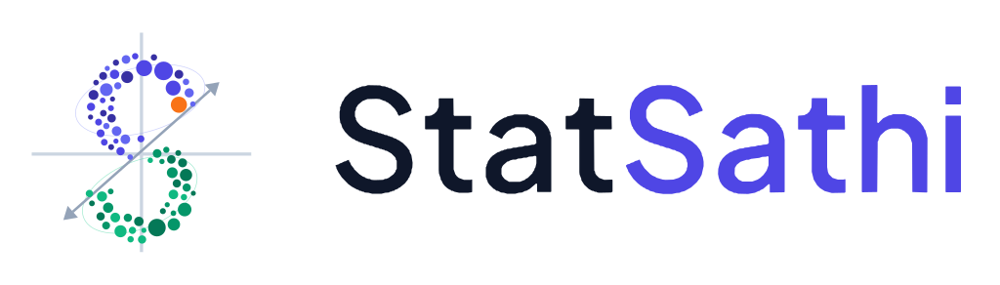
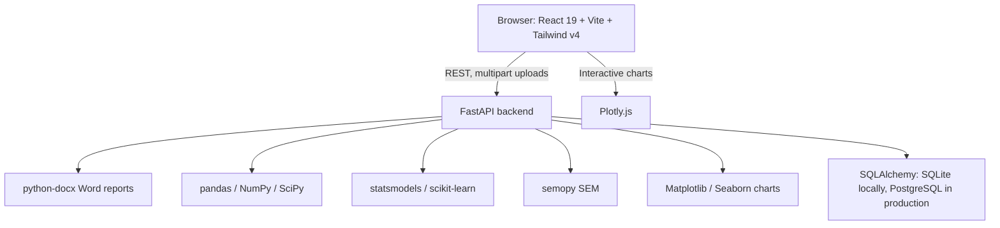

# 📊 StatSathi — Your Research Analytics Companion

<div align="center">
  
  <p><strong>A web platform for statistical analysis of agricultural field experiments and life-science research data</strong></p>
  <p><em>Curated by Ravi, PhD Scholar, ICAR-Indian Institute of Soil Science (IISS), Bhopal</em></p>

  [](https://vitejs.dev/)
  [](https://fastapi.tiangolo.com/)
  [](#-2-how-the-results-are-validated)
</div>

---

## 📑 Table of Contents

1. [What StatSathi Is](#-1-what-statsathi-is)
2. [How the Results Are Validated](#-2-how-the-results-are-validated)
3. [Statistical Modules](#-3-statistical-modules)
4. [Charts, Reports & Exports](#-4-charts-reports--exports)
5. [Data Tools, Projects & Learning Hub](#-5-data-tools-projects--learning-hub)
6. [Architecture & Tech Stack](#-6-architecture--tech-stack)
7. [Local Development](#-7-local-development)
8. [Known Limitations](#-8-known-limitations)
9. [Author & Citation](#-9-author--citation)

---

## 🏛️ 1. What StatSathi Is

**StatSathi** (*Stat* + *Sathi*, "companion" in Hindi and Sanskrit) lets researchers run the analyses they need for field trials and laboratory experiments through a browser, without writing R, SAS or Python code.

It is built around the conventions of Indian agricultural research: CRD, RBD, split-plot and Latin square layouts; Critical Difference (CD) and SE(d); Duncan's DMRT and compact letter displays; and Word reports that can go straight into a thesis chapter.

**Seventeen modules:** Field Layout Generator · Data Preparation · Data Transformation · Descriptive Statistics · Plots · Correlation · Parametric Tests · Non-Parametric Tests · ANOVA · Regression (OLS & PLSR) · Trend & Change-Point Analysis · Time Series & Forecasting · Genotype × Environment (AMMI & GGE Biplot) · Genetic Divergence (D² & Tocher) · PCA · Clustering · Structural Equation Modeling (SEM). A **Figure Composer** then combines charts from any of them into one multi-panel figure at journal size.

---

## ✅ 2. How the Results Are Validated

Every statistical result is checked by an automated test suite (`backend/tests`, 367 tests) that compares StatSathi's output with independent reference implementations or published values:

| Area | Reference |
|---|---|
| Factorial CRD / RBD ANOVA (balanced and unbalanced), Latin square, split-plot error terms | `statsmodels` (Type II / Type III sums of squares) |
| Tukey-Kramer, LSD, Bonferroni, Games-Howell | `scipy.stats.tukey_hsd`, `statsmodels`, Student's and Welch's t-tests |
| Duncan's Multiple Range Test | Published corrected Duncan (Harter 1960) critical ranges |
| Compact letter display | Checked property: two means share a letter **if and only if** they do not differ significantly |
| CB-SEM | `lavaan` published output for Bollen's Political Democracy model (χ², df, CFI, TLI, RMSEA, SRMR and estimates) |
| PLS-SEM | Exact identities: single-item constructs reproduce standardized OLS; two-block weights equal the leading singular vectors |
| t-tests, effect sizes, chi-square, correlation | `scipy`, `statsmodels` (`CompareMeans`, `contingency.association`) |
| OLS and PLS regression, PCA | `statsmodels` OLS, `numpy` eigen-decomposition, `sklearn` |
| Mann-Kendall (with ties, modified and seasonal), Sen's slope, Pettitt, SNHT, Buishand, von Neumann, ITA | Brute-force definitions, `scipy.stats.kendalltau` / `theilslopes`, `statsmodels` ACF and OLS |
| AMMI combined ANOVA, IPCA terms, Eberhart-Russell, Wricke, Shukla, GGE biplot geometry | `statsmodels` ANOVA of the combined model; exact identities (IPCA SS sum to G×E SS, Σ ecovalence = SS(G×E)/r, scores reconstruct the data); polygon sectors checked against the predicted winners |
| Varimax rotation | `statsmodels` `rotate_factors` (same criterion; communalities preserved) |
| Mahalanobis D², Wilks' Λ, canonical variates, Tocher grouping | `scipy.spatial.distance.mahalanobis`, `statsmodels` MANOVA and OLS residuals; a hand-worked Tocher example, and canonical distances that reproduce D² |
| Cluster linkages, cophenetic correlations, silhouette widths | `scipy.cluster.hierarchy`, `sklearn` silhouette scores and K-means |
| Forecasting: ACF/PACF, ADF/KPSS, STL, exponential smoothing, SARIMA, accuracy measures | `statsmodels` (`acf`, `pacf`, `adfuller`, `kpss`, `STL`, `ETSModel`, `SARIMAX`, Ljung-Box) and the textbook prediction-interval formulas for the naive, seasonal naive and drift baselines |
| Skewness / kurtosis standard errors | Values reported by SPSS (n = 10 and n = 30) |
| Multiple imputation: Rubin's rules, Barnard-Rubin degrees of freedom, fraction of missing information | The formulas of van Buuren, *Flexible Imputation of Missing Data* (2nd ed., §2.3) worked by hand, as used by R's `mice::pool`; their limiting cases (identical imputations reduce to the complete-data analysis); the imputers against scikit-learn called directly; data simulated from a known model with values missing at random, where the pooled confidence intervals cover the true coefficients and the pooled mean corrects the complete-case bias |
| Pooled analyses on imputed data: two-group comparison, correlations, ANOVA with the D1 Wald test | With identical imputations every pooled result reduces to the complete-data analysis - Welch's t-test (`scipy`), Fisher-z correlation intervals, and the Type III ANOVA table of `statsmodels` term by term; D1 and its Li-Raghunathan-Rubin (1991) degrees of freedom worked by hand; a simulated factorial trial with missing yields |
| Data preparation: outlier rules, missing-value fills, classes, reshaping and joins | The Tukey, z-score and Iglewicz-Hoaglin definitions written out directly; group means worked by hand; `pandas` `cut`, `qcut`, `melt`, `pivot_table` and `merge` |

Run the suite from `backend/`:

```bash
venv\Scripts\python -m unittest discover -s tests -t .
```

---

## 🔬 3. Statistical Modules

### 3.1 Field Layout Generator
- **Designs:** CRD (one and two factors), RBD (one and two factors), Latin square, split-plot and sub-sub plot.
- Random allocation of treatments to plots in the browser from a **randomization seed**. The seed is shown beside the map, printed on it and included in the file name; entering the same seed with the same design settings regenerates the layout exactly, and **Reshuffle** draws a new seed.
- **Drawing options:** irrigation channels on/off, bund thickness (none / thin / thick), colour styles including a black-and-white print style.
- **Export:** SVG and PNG.

### 3.2 Data Preparation

Check a dataset before analysing it, then clean it with a recipe of steps that run in order.

- **Health check:** rows, complete rows, missing cells, duplicate rows, and for every column its type, gaps, unique values, range or common labels. It flags numbers stored as text ("1,200", "12 kg"), labels written several ways ("T1 ", "t1"), "NA"/"-"/"?" typed in place of an empty cell, empty and constant columns, and values outside the Tukey fences.
- **Suggested fixes:** each problem found becomes a one-click step.
- **Steps:**

| Group | Steps |
|---|---|
| Missing values | Remove rows or mostly-empty columns; fill with the mean, median or most common value (optionally within each treatment or block), a fixed value, interpolation, or the previous/next value; or fill with a model - chained regressions (MICE-style) or the nearest complete rows (KNN), optionally kept at zero or above or within the observed range |
| Rows & columns | Remove duplicates; filter rows (is, is above, is between, is one of, contains, is missing, …); keep or remove columns; rename; sort |
| Clean values | Read columns as numbers (commas and units stripped), whole numbers, text, categories or dates; tidy labels (spaces, capitalisation, text meaning missing); recode values; add a **calculated column** from a formula; group a measurement into classes (equal width, equal counts or your own edges); handle outliers by the 1.5 × IQR, z-score or modified z-score rule — mark, blank, winsorize or remove, optionally judged within each group |
| Reshape & combine | Wide → long, long → wide (mean, median, sum, count, first, min or max of repeats), join a second file (left, inner, outer or right) |

- **Calculated columns:** type a formula such as `[Plot yield (kg)] / [Plot area (m2)] * 10000`, `100 * Germinated / Sown`, `row_mean(Rep1, Rep2, Rep3)`, `100 * Yield / mean(Yield)` or `if_else(Treatment == "Control", 0, log10(Dose))`. Names with spaces or units go in square brackets; the column chips insert them for you, and **Check** shows the first values on the real data before the step is added. Arithmetic (+ - * / ** % //), comparisons, and/or/not, and the functions log, log10, log2, sqrt, exp, abs, round, floor, ceil, clip, arcsin_sqrt, if_else, is_missing, fill, row_mean/sum/min/max, mean, median, sd, min, max, sum, zscore and rank are available. Division by zero or the log of a non-positive number leaves the cell missing. Formulas are read by a small parser that accepts only these pieces - never Python's `eval` - so a formula cannot touch files or the server.
- **Result:** rows, columns, missing cells and issues before → after, a numbered log of what every step did ("Filled 1 missing value in Height (median 91.5)"), and the cleaned table.
- **Use the cleaned data** makes it the workspace dataset, so every module opens on it; it can also be downloaded as CSV or saved to a project.
- **Multiple imputation** (its own tab): the gaps in chosen numeric columns are filled *m* times (default 20) by chained equations drawing from the posterior predictive distribution, then the column means - and optionally an OLS regression - are computed on every completed table and pooled with **Rubin's rules**. Each pooled estimate comes with its standard error, 95% CI, Barnard-Rubin degrees of freedom, p-value, fraction of missing information and between-imputation variance; pooled R² uses Fisher's z. A side-by-side of observed and imputed values flags an imputation model that does not fit, and all imputations download in the long format R's `mice` uses (`.imp`, `.id`). Predictors default to the other numeric columns, leaving out row identifiers such as plot numbers.
- **Pooled analyses** (same tab, optional): each is repeated on every imputed dataset and combined into one answer.
  - **Two-group comparison:** the mean difference with its Welch standard error, pooled with Rubin's rules, with Cohen's d averaged over imputations.
  - **Correlations:** every pair of chosen variables, Pearson or Spearman, pooled on Fisher's z scale (Spearman with the Fieller-Hartley-Pearson variance) and transformed back, with 95% intervals.
  - **ANOVA:** one or two treatment factors, an optional block and interaction. Every term is tested with the pooled D1 multivariate Wald statistic (sum-to-zero contrasts, as in a Type III table), with its relative increase in variance; level means get pooled standard errors, 95% intervals and compact letters from Bonferroni-adjusted or unadjusted pooled pairwise t-tests.
  - Results export to Word, save to a project (so they appear in the project report with their own methods paragraph and references), and download as all imputations in long format.
- **Recipes** are kept in a project (name, description, the file they were written for) or downloaded as a JSON file. **Load** lists the recipes from every project; a recipe opened from a project can be updated in place. The Projects page lists each project's cleaning recipes with **Open** (straight into Data Preparation), download and delete, so next season's sheet is cleaned the same way and the log can go straight into a methods section.

### 3.3 Data Transformation & Scaling
| Method | Notes |
|---|---|
| `log10`, `ln` | Values must be > 0 (no automatic +1 offset). |
| `sqrt` | Values must be ≥ 0 (no automatic +0.5 offset). |
| `arcsine` | arcsin(√p). If the maximum is above 1 (and at most 100), values are treated as percentages and divided by 100, with a note. |
| `boxcox` | λ estimated by maximum likelihood; values must be > 0. λ is shown before you apply the result. |
| `yeojohnson` | Works with zero and negative values; λ is shown before you apply the result. |
| `zscore` | Uses the sample standard deviation (n − 1). |
| `minmax` | Scales to [0, 1]. |
| `snv`, `msc` | Row-wise spectral corrections; MSC uses the mean spectrum as reference. |
| `sg_smooth`, `sg_1der`, `sg_2der` | Savitzky-Golay filter (window up to 7, polynomial order 2, or 3 for the second derivative); settings reported in a note. |

Transformed columns are added with suffixes such as `_Log10` or `_ZScore` and can be downloaded as CSV. Before applying, the dialog shows skewness, kurtosis and the Shapiro-Wilk p-value before and after transformation.

### 3.4 Descriptive Statistics
- N, missing count and %, mean, median, mode (only when a value repeats), SD, SE, variance, minimum, maximum, range, IQR.
- Skewness and excess kurtosis (bias-corrected, as in SPSS) with their standard errors.
- C.V. % (shown as N/A when the mean is zero).
- Normality: Shapiro-Wilk; Lilliefors (Kolmogorov-Smirnov with estimated mean and SD); D'Agostino-Pearson for n ≥ 8.
- Percentiles P10, P25, P50, P75, P90.
- Outliers by Tukey's 1.5 × IQR fences; |z| > 3 outliers.
- Optional breakdown by a grouping variable.
- Interactive Plotly histogram, box plot and normal Q-Q plot.

### 3.5 Plots (Publication Charts)
Server-rendered with Matplotlib/Seaborn:
- **Classic chart types:** box, histogram (optional KDE), scatter (optional regression line), line and bar (optional SD / SE / 95% CI error bars), violin, normal Q-Q, pie, multi-line and PCA biplot.
- **Modern chart types:**
  - Distributions: raincloud plot, box plot + beeswarm, ridgeline plot, ECDF (cumulative distribution).
  - Comparisons: mean ± 95% CI dot plot, lollipop chart, dumbbell chart (two conditions), paired before/after lines (with a paired t-test), two-factor means heatmap, estimation plot (difference in means with its 95% CI on a floating axis) and paired estimation plot.
  - Relationships: scatter with marginal histograms and densities (r, p and an optional regression line with 95% band), 2-D density contours, hexbin plot.
  - Composition: mosaic plot (tiles coloured by standardized residuals, with a chi-square test), radar chart of group profiles.
- The form only asks for the inputs each chart needs, and every chart explains what it shows in a short note under the figure.
- **Controls:** title, axis-label and tick font sizes and families; aspect ratio; legend position; grid; axis limits; colour palettes.
- **Export:** PNG or SVG at 150, 300 or 600 DPI.

### 3.6 Correlation
- **Coefficients:** Pearson or Spearman, using pairwise-complete observations.
- **Significance:** two-sided p-value and n for every pair, shown in a table under the heatmap. The Word report marks significant coefficients with * / ** / ***.
- **Variables:** all numeric columns by default; click variable chips to include or leave out columns.
- **Charts:**
  - Heatmap: full matrix, lower triangle or upper triangle, on a fixed −1 to 1 colour scale.
  - Scatter matrix (pairs plot), up to 12 variables: scatter plots below the diagonal (least-squares line for Pearson, LOWESS trend for Spearman), histogram with density curve on the diagonal, and coefficients with significance stars above the diagonal, larger and more strongly shaded as the correlation strengthens.
  - Correlogram: circles above the diagonal sized and coloured by the coefficient, with × on non-significant pairs, and coefficients below the diagonal.
  - Correlation with one target: every other variable's coefficient with the chosen target (for example yield), sorted, with Fisher-z 95% confidence intervals and non-significant pairs in grey.
  - Correlation network: variables on a circle joined by lines for correlations above a chosen |r| (and p < 0.05); line thickness shows strength, colour shows sign.
  - Variable order: as in the dataset, or clustered so that strongly related variables sit next to each other.
  - 11 colour maps (including colour-blind-safe cividis) and zoom controls.
- **Export:** heatmap PNG at 150, 300 or 600 DPI, matrix as CSV, Word report.

### 3.7 Parametric Tests
- **One-sample t-test:** mean, 95% CI, Cohen's d.
- **Independent two-sample t-test:** Levene's test selects Student's or Welch's t, and the screen says which was used. Both results are returned. Reports mean difference, SE, 95% CI, Cohen's d (pooled SD) and Hedges' g.
- **Paired t-test:** mean difference, SD of differences, 95% CI, Cohen's d_z.
- **Z-tests (one- and two-sample):** large-sample tests using the sample SD, with 95% CI.
- Shapiro-Wilk checks on each group, or on the paired differences.
- Data layout: each group or measurement in its own column.
- **Chart styles:** classic, raincloud, box + beeswarm, mean ± 95% CI (with a p-value bracket for two groups or a reference line at the hypothesized mean), estimation plot for two-sample tests, and paired lines or a paired estimation plot for paired tests. The chosen style is used in the Word report.

### 3.8 Non-Parametric Tests
| Test | Effect size |
|---|---|
| Mann-Whitney U (2 independent groups) | Rank-biserial correlation |
| Wilcoxon signed-rank (2 paired columns) | Matched-pairs rank-biserial correlation (zero differences are excluded, as in the test) |
| Kruskal-Wallis H (3+ independent groups) | η²(H) |
| Friedman (3+ repeated measures) | Kendall's W |
| Chi-square test of independence | Cramér's V |

Chi-square reports the Pearson χ² with expected counts. For 2×2 tables it also gives the Yates-corrected χ² and Fisher's exact test, and it warns when more than 20% of expected counts are below 5. Medians and IQRs are reported for every group.

**Chart styles:** classic, raincloud and box + beeswarm for group comparisons, paired lines for the Wilcoxon test, and a mosaic plot for the chi-square test.

### 3.9 ANOVA — Design of Experiments
**Designs**
- One-factor CRD and RBD.
- Two-factor CRD and RBD.
- Split-plot, with separate Error (a) and Error (b).
- Latin square.
- Multi-factor CRD and RBD.

**ANOVA table**
- Degrees of freedom, SS, MS, F and exact p-values.
- Factorial CRD models use Type III sums of squares, which are valid for unbalanced data.
- For one-factor CRD with unequal variances, Welch's ANOVA is reported in a note alongside the classic table.

**Mean comparison**
- SE(d) and CD at 5% and 1% for each effect.
- Split-plot gives four CDs (Gomez & Gomez), including "A at the same level of B".
- Grand mean, CV% and SE(m).

**Post-hoc tests:** Tukey's HSD (Tukey-Kramer), Fisher's LSD, Duncan's DMRT, Bonferroni and Games-Howell (one-way only).

**Letters:** compact letter display (Piepho 2004), built from exactly the pairwise tests reported. Split-plot letters use the correct error term for comparisons within and across main plots.

**Data checks:** block designs must have every treatment in every block. Missing plots, non-Latin layouts and empty factorial cells are rejected with a clear message rather than analysed incorrectly.

**Output:** interactive Plotly bar charts with letters and error bars, a cross-tabulated interaction grid, and a Word report.

**Chart styles:** one-factor designs add raincloud, box + beeswarm and mean ± 95% CI charts with the post-hoc letters above each treatment; two-factor designs add means ± 95% CI by factor B and an A × B means heatmap.

### 3.10 Regression
**Simple and multiple OLS**
- Coefficients, SE, t, p and 95% CI.
- R², adjusted R², F-test.
- Interactive predicted-vs-actual chart and a fitted/residual values table.

**PLS regression** (one or more responses; predictors scaled internally)
- Components used and R² per response.
- Share of standardized X and Y variance explained per component.
- VIP scores (VIP > 1 marks important predictors).
- Coefficients in original units, with intercepts.
- X and Y loadings, and scores.

**Charts (simple and multiple OLS)**
- Predicted vs actual.
- Simple regression: fitted line with 95% confidence band (mean response) and 95% prediction band (new observations), and the fitted equation.
- Residual diagnostics in four panels: residuals vs fitted, normal Q-Q, scale-location, and residuals vs leverage with observations of high Cook's distance (> 4/n) highlighted; hover shows the spreadsheet row.
- Coefficient plot: estimates with 95% confidence intervals.

**Export:** charts as PNG, JPEG or SVG at any size preset, and a Word report.

### 3.11 Trend & Change-Point Analysis
For long-term series such as annual rainfall, temperature, yield or soil carbon: one row per time step, with a year, date or numeric time column (or row order), up to 20 variables at once and 8 to 2,000 observations per variable. Dates become decimal years, so slopes are per year; repeated time values are averaged, with a note.

| Question | Tests |
|---|---|
| Is there a monotonic trend? | Mann-Kendall (tie-corrected variance, Kendall's τ); modified Mann-Kendall for autocorrelated series (Hamed & Rao 1998), with lag-1 autocorrelation to say which to report; seasonal Mann-Kendall (Hirsch et al. 1982) when a season column such as Month is given |
| How large is it? | Sen's slope with its 95% confidence interval, change over the period and as % of the mean; ordinary least-squares slope, 95% CI and R² for comparison |
| Did the series shift abruptly? | Pettitt change-point test (year of change, means before and after) |
| Is the series homogeneous? | SNHT, Buishand Q and R, von Neumann ratio (p-values from 10,000 simulated series, fixed seed), and the Wijngaard et al. (2003) useful / doubtful / suspect class |
| Did low, medium and high values change differently? | Innovative Trend Analysis (Şen): trend indicator D, ITA slope and % change for each third of the data |

- **Significance level:** 0.01, 0.05 or 0.10.
- **Charts:** time series with LOESS smooth, Sen's slope line and a significant change point with its before/after means; ITA scatter against the 1:1 line; homogeneity panel (Pettitt U, SNHT T and Buishand cumulative deviations over time); and, for several variables, the change over the period (% of the mean) with confidence intervals.
- **Export:** summary table as CSV, charts as PNG, Word report with every test and chart.

### 3.12 Time Series & Forecasting
For a single series measured at regular intervals (daily, weekly, monthly, quarterly or yearly). Dates set the seasonal period automatically; a numeric time column or plain row order also works, and gaps of up to 10% are filled by interpolation with a note.

**Understanding the series**
- Stationarity: ADF (H0: not stationary) and KPSS (H0: stationary), with the number of regular and seasonal differences those tests suggest.
- Autocorrelation: ACF and PACF with their 95% bounds and the Ljung-Box test, to show whether the series has structure worth modelling.
- Decomposition into trend, seasonal pattern and remainder (STL for seasonal series, a centred moving average otherwise), with the strength of trend and of seasonality on a 0-1 scale.
- Seasonal plot: every season drawn on top of the others with their average.

**Models compared** (all fitted without the test period, then scored on it)
- Baselines: naive, seasonal naive and drift, each with its textbook prediction interval.
- Exponential smoothing (ETS state-space models): simple, Holt's linear trend, damped trend, and Holt-Winters additive and multiplicative.
- SARIMA with an automatic order search: the number of differences comes from KPSS and the strength of seasonality, then the (p, q) and (P, Q) orders with the smallest corrected AIC.
- **Accuracy:** RMSE, MAE, MAPE and MASE on the test period (MASE below 1 beats a seasonal naive forecast). The most accurate model is refitted on the whole series to produce the forecast.

**Forecast**
- Forecast table and chart with 80% and 95% prediction intervals, alongside the fitted values.
- Residual checks of the chosen model: residuals over time, their autocorrelation (Ljung-Box) and their distribution (Shapiro-Wilk), because the intervals depend on the residuals behaving like noise.
- Optional log transformation for series that grow proportionally; forecasts and intervals are back-transformed.
- **Export:** forecast as CSV, charts as PNG, Word report with the diagnostics, the model comparison and the forecast.

### 3.13 Genotype × Environment (AMMI & GGE Biplot)
For multi-environment trials (varieties across locations, years or seasons): long-format data with genotype, environment, an optional replicate/block column and one trait. Every genotype must be tested in every environment; at least 3 genotypes and 3 environments.

- **AMMI analysis of variance:** environments, replications within environments, genotypes and G × E, with the interaction split into IPCA terms (Gollob degrees of freedom, F-tests and % of G × E explained). Environments are tested against replications within environments when a block column is given. Unreplicated or unbalanced data are analysed on genotype × environment means, without F-tests.
- **Stability statistics for every genotype:** mean and rank; Eberhart-Russell regression slope b (with a test of b = 1), deviation variance S²d and R²; Wricke's ecovalence (Wi² and %); Shukla's stability variance; coefficient of variation across environments; AMMI stability value (ASV); yield stability index (YSI = rank of ASV + rank of mean); rank by distance from the GGE ideal genotype.
- **GGE biplot:** environment-centred data, optionally scaled by environment SD; singular value partitioning chosen per view (symmetric for which-won-where, genotype-focused for mean vs stability and ideal genotype, environment-focused for environment evaluation) or fixed by the user.
- **Environments:** mean and environment index, IPCA scores, discriminating ability (vector length), representativeness (angle with the average-environment axis), the winning genotype, mega-environments, and correlations between environments.
- **Traits where lower is better** (disease score, days to maturity): ranks are reversed and the GGE biplot uses the negated values, so "best" still points the right way.
- **Charts:** GGE biplot, which-won-where polygon with sector boundaries, mean vs stability, ranking relative to the ideal genotype, discriminativeness vs representativeness, AMMI1 and AMMI2 biplots, adaptability regression lines, and a sorted genotype × environment means heatmap.
- **Export:** stability table as CSV, charts as PNG, Word report with the ANOVA, stability, environment and means tables and all charts.

### 3.14 Genetic Divergence: D² & Tocher
Groups germplasm by multivariate distance — the standard analysis for choosing divergent parents. One row per plot (or per genotype): a genotype column, an optional replicate column and at least 2 traits.
- **Mahalanobis D²** between genotype means. With replication the distances use the error variance-covariance matrix (Rao's D²); with a single row per genotype they use the covariance matrix among genotypes, with a note on screen.
- **Wilks' Λ** with Rao's F approximation tests whether the genotype mean vectors differ at all; blocks are accounted for when a replicate column is given.
- **Tocher's method** of grouping (Rao 1952): the threshold θ, cluster membership, and the average intra- and inter-cluster D² (and D). Genotypes that cannot join a cluster stand alone.
- **Cluster means** for every trait, so parents can be chosen that are both divergent and good performers.
- **Contribution of each trait** to divergence: how often each trait ranks first over all pairs of genotypes (Singh 1981).
- **Charts:** Tocher cluster diagram (circles sized by intra-cluster distance, joined by inter-cluster distances), D² heatmap ordered by cluster, UPGMA dendrogram with labels coloured by Tocher cluster, canonical variates with cluster outlines, cluster-means heatmap and trait contributions.
- **Export:** D² matrix as CSV, charts as PNG, Word report with every table and chart.

### 3.15 PCA
- Based on the correlation matrix (standardized data) or the covariance matrix.
- Eigenvalues are those of the sample correlation matrix, so they sum to the number of variables and the Kaiser rule (λ ≥ 1) applies directly.
- **Screen tabs:** eigenvalues with % and cumulative variance explained; eigenvectors and correlation loadings; observation scores with their cos² on the biplot plane; varimax-rotated loadings; charts.
- **Parallel analysis** (Horn; 95th percentile of 200 random datasets, fixed seed) for how many components to keep, alongside the Kaiser rule.
- **Biplot options:** any pair of components; distance biplot (scores and eigenvectors: distances between observations) or correlation biplot (standardized scores and correlation loadings: angles between variables); group outlines as 95% confidence ellipses of the means, 95% data ellipses or convex hulls; observation labels from any column (the 12 furthest from the centre when there are more than 40).
- **Varimax rotation** (Kaiser normalization) of the retained components (parallel analysis by default, or a chosen number), with communalities and variance explained per rotated component.
- **Charts:** biplot, scree plot with the parallel-analysis threshold, correlation circle coloured by quality of representation (cos²), variable contributions, correlation-loadings heatmap and varimax-loadings heatmap.
- **Export:** Word report including the rotated loadings and all charts.

### 3.16 Clustering
- Variables are standardized first.
- **Methods:** K-means (k-means++, fixed random seed) and hierarchical clustering, cut by the number of clusters or by height.
- **Linkage:** Ward, average (UPGMA), complete, weighted average (WPGMA), single, centroid (UPGMC) or median (WPGMC).
- **Distance:** Euclidean, Manhattan, 1 − Pearson r (groups observations with a similar pattern rather than similar magnitudes) or cosine. Ward, centroid and median linkage need Euclidean distances.
- **Choosing the number of clusters:** average silhouette width for k = 2…10 for both methods, the K-means elbow (within-cluster sum of squares) and the Calinski-Harabasz index, with the best k marked.
- **Linkage comparison:** the cophenetic correlation of every linkage method on your data, so you can pick the tree that preserves the distances best.
- **Dendrogram styles:** interactive dendrogram; a rectangular tree with branches and labels coloured by cluster and a dashed line at the cut; a circular tree; and a heatmap with the observation tree beside it and a variable tree above it. Leaves can be labelled by any column.
- **Charts:** PCA-projected cluster scatter with convex-hull outlines and centroid markers; 4 palettes.
- **Cluster profiles:** mean of each variable and the size of each cluster.
- **Quality measures:** cophenetic correlation, silhouette width and K-means inertia.
- **Profile charts:** silhouette plot (width of every observation, grouped by cluster), radar chart of cluster means, and a heatmap of cluster means on the standardized scale.
- **Export:** Word report with cluster profiles, quality measures, the linkage comparison, the k table and the trees.

### 3.17 Structural Equation Modeling (SEM)
The SEM card has two tabs:
- **Visual canvas:** drag and drop constructs, assign their indicator columns and draw structural paths; runs CB-SEM or PLS-SEM.
- **Syntax editor:** write the model in lavaan syntax (CB-SEM) and get a path diagram.

Only recursive models (no feedback loops) are supported.

**CB-SEM (covariance-based)**
- Maximum likelihood via `semopy`, equivalent to lavaan's default ML.
- Standardized and unstandardized estimates, SE, z and p.
- χ², df, p, CFI, TLI, RMSEA, SRMR, AIC, BIC.
- Needs at least 2 indicators per construct.

**PLS-SEM**
- PLS path algorithm (Mode A, path weighting scheme).
- Path coefficients with bootstrap SE, t, p and 95% percentile CI: 1,000 resamples with a fixed seed, so results are reproducible.
- Outer loadings and weights, R² and adjusted R².
- No covariance-based fit indices, because they are not defined for PLS-SEM.

**Both methods**
- Cronbach's α, composite reliability and AVE.
- HTMT.
- Fornell-Larcker matrix.
- Word and text reports.

---

## 🎨 4. Charts, Reports & Exports

- **Interactive charts (Plotly.js):** Descriptive Statistics, ANOVA, Regression and Clustering.
- **Server-rendered charts (Matplotlib/Seaborn):** Plots, Correlation, PCA, Trend analysis, Time series and forecasts, G × E biplots, Genetic divergence, the clustering trees, and the ANOVA / t-test / non-parametric summary figures.
- **One figure style for every chart:** server figures and interactive charts share one definition (`figure_style.json`): clean axes without top/right borders, light grid, left-aligned titles, consistent fonts and colours.
- **Colour palettes:** StatSathi, Okabe-Ito, Paul Tol bright and Viridis (all three colour-blind safe), Field & soil, and Greyscale for print. The last palette you pick is remembered in the browser and offered in every module; the older module-specific palettes are still available.
- **Figure size presets:** screen & slides, journal single column (85 mm), 1.5 column (120 mm), double column (180 mm), thesis page (150 mm) and poster (300 mm). A preset sets the figure's physical width and scales fonts, lines and markers, so an 85 mm figure really is 85 mm wide with legible text.
- **Export formats and resolution:** 150, 300 or 600 DPI.
  - Plots module: PNG, JPEG, SVG, plus TIFF (LZW), PDF and EPS for journal submission. Text stays editable in SVG, PDF and EPS.
  - Interactive charts (Descriptive Statistics, ANOVA, Regression, Clustering): PNG, JPEG and SVG at the chosen size preset.
  - Field Layout Generator: SVG and PNG.
- **Correlation heatmaps** always use a fixed −1 to 1 colour scale, so colours mean the same coefficient in every figure.
- **Word reports:** every analysis module exports a genuine `.docx` file, generated on the server with `python-docx` (`POST /reports/docx`).
  - Opens in Microsoft Word, WPS, LibreOffice and Google Docs.
  - Header block with the logo, test applied, dataset, author and date; numbered sections; real Word tables with repeating header rows; page numbers in the footer.
  - Charts are embedded as images (server-rendered figures, and the Plotly charts for Regression and ANOVA post-hoc).
  - Plain-text (`.txt`) reports are still available.
- **Figure composer:** combine up to 12 charts into one multi-panel figure.
  - Drop in the PNGs downloaded from any module (JPEG and TIFF are accepted too), reorder them, and give each panel its own caption.
  - Panel labels (a), (b), (c) - or A, B, C, with or without brackets - placed above or inside each panel, and an overall figure caption.
  - Two layouts: fill each row (panels in a row share a height and use the full width, so nothing is wasted when charts have different shapes) or equal widths (columns line up).
  - Choose the panels per row, the gap between panels, the figure width preset and a white or transparent background. Panels keep their own proportions, so nothing is stretched.
  - Live preview, then export as PNG, TIFF (LZW), PDF, SVG, EPS or JPEG at 150-1200 DPI. A double-column figure really is 180 mm wide.
- **Save to Project:** every analysis module can save its settings and full result into one of your projects, together with the content of its Word report (tables and charts; charts are left out if they would make the saved result too large).
- **Project report:** on a project's page, one Word document for a thesis chapter or manuscript (`POST /workspace/projects/{id}/report`). Choose which saved analyses and cleaning recipes go in, and give it a title.
  - **Data:** the project's datasets with their size and upload date.
  - **Data preparation:** each chosen recipe written out step by step.
  - **Statistical methods:** a paragraph for every analysis, written from its saved settings - the design, factors, block, post-hoc test, variables, test variant, model options - plus the software used.
  - **Results:** each analysis with the same tables and charts as its own Word export. Results saved before reports were kept show their settings and say how to export the tables.
  - **Activity log:** datasets uploaded, analyses saved and recipes saved or updated, in order (optional).
  - **References:** the original sources for every method used, in APA style (optional).
- **Methods text:** the same methods paragraphs and reference list on screen, with **Copy all** for pasting into a manuscript (`GET /workspace/projects/{id}/methods`). The paragraphs are generated from the saved settings: read them against what you did, and check the references against your journal's style (they are given without DOIs).

---

## 💾 5. Data Tools, Projects & Learning Hub

- **Spreadsheet editor (`DatasetViewerModal`):**
  - Edit cells.
  - Add, delete, rename and move rows and columns.
  - Save the edited data back to the analysis without re-uploading.
- **Excel to CSV converter:** upload `.xlsx`/`.xls` and download a clean CSV.
- **Projects (`/projects`):** stored in the database under your account, so they follow you across devices.
  - Name, status, sample and variable counts, test used, and a task checklist.
  - Datasets: upload CSV/Excel files to a project and download them later.
  - Saved analyses: results saved from any module, downloadable as JSON.
  - **Analyse a dataset you have already saved:** the dashboard's **Use a saved dataset** button and every analysis screen's "From my projects" tab open the files stored in your projects, so a dataset can be analysed again without uploading it a second time. It works in Descriptive Statistics, Parametric and Non-Parametric tests, ANOVA, Regression, Correlation, Plots, Data Transformation, PCA, Clustering, Trend, G × E, Genetic Divergence, Time Series and the SEM canvas. The SEM syntax tool and the figure composer keep their own uploaders.
  - **Reopen a saved analysis:** every saved result has an **Open** button that sends it back to the module that produced it - Descriptive Statistics, Correlation, Parametric and Non-Parametric tests, ANOVA, Regression, PCA, Clustering, SEM, Trend, G × E, Genetic Divergence and Time Series - showing its tables again. Charts are not stored with a result (to keep it small), so when the result was run on a dataset saved in the same project the module offers to load that dataset and restore the settings, ready to run again.
  - **One dataset for the whole session:** the file you choose - on the dashboard or in any module - becomes the workspace dataset, so the next module you open already has it selected. "Choose Other Dataset" (or **Remove File** on the dashboard) drops it everywhere. It lives in the browser's memory for the session, so reloading the page asks for it again.
  - Cleaning recipes from Data Preparation, which open straight back into it.
  - A **Project Report** panel: build the combined Word report or show the methods text (see section 4).
  - Storage limits: 10 MB per dataset, 5 MB per saved result, 256 KB per recipe, 100 MB per account (usage bar shown on the page).
  - New accounts start with a sample "Dummy project"; projects from the older browser-only version are imported automatically on first visit.
- **Learning Hub:** six illustrated articles:
  - the StatSathi operation manual;
  - basic statistics and normality;
  - Pearson vs Spearman correlation;
  - OLS and PLS regression;
  - ANOVA and experimental designs, with Duncan's DMRT;
  - K-means and hierarchical clustering.
- **Accounts:** email and password sign-in (bcrypt-hashed passwords, JWT sessions). All analyses require a signed-in user.
  - **Forgot password:** enter your email address and a one-time link (valid for an hour) arrives to choose a new password. The answer is the same whether or not the address has an account.
  - **Email verification:** new accounts get a confirmation link; until it is used a reminder offers to send it again.
  - **Change password** from Edit Profile. Resetting or changing a password signs out every other device.
  - **Protection:** passwords need at least 8 characters; email addresses ignore capitalisation; five wrong passwords lock sign-in for that account (from that network) for 15 minutes, and signups and reset emails are rate limited. Reset and verification links are single-use, expire, and are stored only as hashes.
- **Sharing projects:** the owner invites people by email from the project's Sharing panel, as a **viewer** (opens saved results and recipes, downloads datasets, builds the methods text and Word report) or an **editor** (can also add datasets, analyses and recipes, update the checklist and status, and delete what they added). Only the owner renames or deletes the project, deletes other people's items and manages members. The invitee gets an email and accepts on their Projects page; their email address must be confirmed first, so nobody can claim an invitation by signing up with someone else's address. Members can leave at any time; what someone added stays in the project and passes to the owner (counting towards the owner's storage). Anyone without access gets "not found".
- **Your data:** Edit Profile offers **Download my data**, a ZIP with the profile, every own project (checklist, datasets exactly as uploaded, saved analyses with their full results, recipes in the loadable recipe-file format) and whatever the user added to projects shared with them. **Delete account** needs the password and the word DELETE; it removes the account, its sign-in links and memberships and the projects it owns (for everyone they were shared with), while what the user added to other people's projects stays there with the owner.
- **Theme:** light and dark mode, with the logo switching to match.

---

### Using StatSathi on any device

- **Keyboard:** Escape closes the dialog in front (a data editor opened over an analysis closes first), a dialog takes the keyboard focus when it opens, and focus returns to where you were when it closes.
- **Screen readers:** dialogs are announced as dialogs, icon-only close buttons are labelled, and the navigation marks the current page.
- **Phones and small tablets:** the sidebar becomes a navigation bar along the bottom of the screen, pages use less padding, and dialogs fit the screen width with their settings stacked above the results.
- **Dark mode:** the dashboard, projects and learning pages follow the theme; the analysis dialogs stay light, with readable form fields in either theme.

---

## ⚡ 6. Architecture & Tech Stack



**Frontend**
- React 19 and Vite.
- Tailwind CSS v4.
- Plotly.js for interactive charts.
- Lucide icons.
- `frontend/src/components` holds one modal component per module; each is loaded on first use, so the first page load does not include Plotly or the analysis screens. Modules are rendered through a portal, because an animated container would otherwise become the positioning context for the modal and push it down the page.
- Shared pieces: `hooks/useDataset.js` (the dataset a screen works on: the file, where it came from, and its columns), `components/DatasetPicker.jsx` (upload, or pick a dataset stored in a project) and `utils/analysisHandoff.js` (handing a saved analysis from Projects back to its module).
- **Tests:** Vitest with Testing Library (`npm test`), covering the dataset hook, the dataset picker and the saved-analysis handoff.
- Pages have their own URLs (`/`, `/projects`, `/learning`); `vercel.json` serves `index.html` for them.

**Backend** (`backend/app`)
- `analysis.py`: mounts the per-module routers under `/analyze`.
- `modules/`: one file per analysis area (`anova.py`, `correlation.py`, `regression.py`, ...); `common.py` reads uploaded CSV/Excel files.
- `posthoc.py`: post-hoc tests, compact letter displays and a fast studentized-range distribution.
- `sem_engine.py`: CB-SEM and PLS-SEM.
- `measures.py`: effect sizes, correlation tests, PCA, PLS summaries, cluster quality and distribution measures.
- `workspace_routes.py`, `models.py`: projects, datasets and saved results (`/workspace/*`), each owned by one user.
- `reports.py`: builds `.docx` reports from structured sections, tables and images (`/reports/docx`).
- `modules/chart_gallery.py`: the modern chart types (raincloud, ridgeline, estimation plots, mosaic, radar, ...) and the statistics they draw (t intervals, regression bands, standardized residuals).
- `modules/result_charts.py`: alternative chart styles for test and ANOVA results (`/analyze/result-chart`), annotated with the analysis's p-value, letters or reference value.
- `modules/pca_charts.py`: biplot options, scree plot with parallel analysis, correlation circle, contributions, loadings heatmaps, varimax rotation and observation quality.
- `gxe.py`: AMMI ANOVA and scores, stability statistics and GGE biplot geometry; `modules/gxe.py` (`/analyze/gxe`) and `modules/gxe_charts.py` handle data checks and the biplot views.
- `divergence.py`: error SSCP and Wilks' Λ, Mahalanobis D², Tocher grouping, character contributions and canonical variates; `modules/divergence.py` (`/analyze/divergence`) and `modules/divergence_charts.py`.
- `timeseries.py`: stationarity tests, correlogram, decomposition and strength measures, baseline/ETS/SARIMA forecasts and accuracy measures; `modules/timeseries.py` (`/analyze/timeseries`) handles the date grid, the holdout comparison and the transformations, and `modules/timeseries_charts.py` draws the six charts.
- `modules/cluster_charts.py`: rectangular, circular and heatmap dendrograms, and the chart for choosing the number of clusters.
- `figure_composer.py`: the multi-panel layout (grid shape, justified rows, panel labels, caption wrapping) and the composed figure; `modules/figure_composer.py` serves the preview (`/analyze/figure/compose`) and the export (`/analyze/figure/download`).
- `trend.py`: Mann-Kendall family, Sen's slope, Pettitt, SNHT, Buishand, von Neumann and Innovative Trend Analysis; `modules/trend.py` (`/analyze/trend`) and `modules/trend_charts.py` handle time columns, seasons and charts.
- `figure_style.py` + `assets/figure_style.json`: the shared figure style (palettes, size presets, export formats). The frontend keeps an identical copy in `src/theme/figure_style.json`; a test fails if the two drift apart.
- `auth.py`, `auth_routes.py`: sign-up, login, JWT sessions, password reset and change, email verification.
- `account_security.py`: one-time email tokens and rate limits; `emailer.py`: account and invitation emails (log or SMTP).
- `project_access.py`: who may read or change a project (owner, editor, viewer); `collaboration_routes.py`: members and invitations.
- `account_data.py`: the account export (ZIP) and account deletion.

**Hosting:** frontend on Vercel, backend on Render, PostgreSQL on Supabase.

**CI:** GitHub Actions workflows in each repository run the backend test suite (`backend/.github/workflows/tests.yml`) and the frontend lint and build (`frontend/.github/workflows/ci.yml`).

---

## 🚀 7. Local Development

### Prerequisites
Node.js 18+, Python 3.10+, and Graphviz (only needed for SEM path diagrams).

### Backend
```bash
cd backend
python -m venv venv
venv\Scripts\activate
pip install -r requirements.txt
copy .env.example .env
uvicorn app.main:app --reload --port 8000
```

`backend/.env` must define:
- `DATABASE_URL`: e.g. `sqlite:///./statsathi_local.db` for local work.
- `JWT_SECRET_KEY`: generate one with `python -c "import secrets; print(secrets.token_hex(32))"`.

The server refuses to start without them. Never commit `.env`.

Interactive API docs: `http://localhost:8000/docs`.

### Frontend
```bash
cd frontend
npm install
npm run dev
```

By default the app calls `http://127.0.0.1:8000` on localhost and the hosted backend elsewhere. To use another backend address, set `VITE_API_URL` in `frontend/.env.development.local`, for example `VITE_API_URL=http://127.0.0.1:8001`.

### Tests
```bash
cd backend
venv\Scripts\python -m unittest discover -s tests -t .
```

The tests run the API in-process against a temporary SQLite database; no running server is needed.

```bash
cd frontend
npm test
```

The frontend tests (dataset hook and picker, analysis handoff, data-preparation recipes) run in jsdom with Vitest and Testing Library; `npm run test:watch` reruns them as files change.

### Production build
```bash
cd frontend
npm run build
```

On the backend host, set `DATABASE_URL` and `JWT_SECRET_KEY` as environment variables. For account emails also set `FRONTEND_URL` (the web app's address, used in the links), `EMAIL_BACKEND=smtp` and the `SMTP_HOST`, `SMTP_PORT`, `SMTP_SECURITY`, `SMTP_USERNAME`, `SMTP_PASSWORD` and `SMTP_FROM` of your mail provider, and `TRUST_PROXY_HEADERS=true` behind a proxy such as Render so rate limits see each visitor's address. Without SMTP settings, emails are only written to the server log (see `backend/.env.example`). Set `CORS_ORIGINS` to the web app's address (the default also admits any `*.vercel.app` site; narrow `CORS_ORIGIN_REGEX` once the address is fixed), and point an uptime monitor at `GET /health`, which answers 503 when the database is unreachable. Requests are limited to 50 MB and analysis tables to 25 MB (`MAX_REQUEST_MB`, `MAX_TABLE_UPLOAD_MB`). Unexpected server errors return a short reference that is also written to the log with the full traceback, and the web app shows a recovery screen instead of a blank page if a screen crashes.

---

## 🧭 8. Known Limitations

- **ANOVA:**
  - Missing-plot estimation is not supported: incomplete blocks are rejected.
  - The ANOVA table has no tabulated F column (exact p-values are given instead).
  - For unbalanced one-way data the CD row uses the average replication; the post-hoc letters use exact per-pair standard errors.
- **PCA:** the biplot and component charts are PNG images (150 DPI) rather than size-preset exports.
- **Result chart styles:** downloaded as PNG at screen resolution; journal formats (TIFF/PDF/EPS) are available for charts made in the Plots module.
- **SEM:**
  - Recursive models only.
  - χ²/df and the RMSEA confidence interval are not reported.
  - The PLS-SEM bootstrap uses 1,000 resamples; the number cannot yet be changed on screen.
- **Clustering:** cluster profiles show means but not standard deviations; the circular tree and the heatmap are drawn for up to 1,500 observations, and dendrogram leaf labels are hidden beyond 150.
- **Trend analysis:**
  - Series must be evenly ordered in time; gaps are not filled and irregular spacing is not modelled.
  - Pettitt p-values use the usual large-sample approximation; SNHT, Buishand and von Neumann p-values assume normally distributed homogeneous series.
  - Forecasting and decomposition live in the separate Time Series module.
- **G × E analysis:**
  - Missing genotype × environment cells are not estimated: every genotype must be tested in every environment.
  - One trait at a time; genotypes and environments are treated as fixed effects (no mixed-model BLUPs).
  - Unreplicated trials get sums of squares without F-tests (no Cornelius F_R tests for IPCA terms).
- **Time series:**
  - One series at a time; there is no place yet for explanatory variables (rainfall, price) alongside the history.
  - Observations must be evenly spaced; gaps above 10% of the series are rejected rather than filled.
  - Prediction intervals assume the residuals behave like noise and are roughly normal, and they ignore the uncertainty in the estimated parameters.
  - The SARIMA search covers p, q up to 2 and P, Q up to 1 by corrected AIC, which is narrower than a full stepwise search.
  - Hierarchical or grouped forecasts, and automatic Box-Cox selection, are not included.
- **Genetic divergence:**
  - Tocher's method follows the common criterion (a genotype joins while its average D² to the cluster stays below the largest of the genotypes' smallest D² values); other software may group slightly differently.
  - The contribution of each trait depends on the order in which the traits are selected, as in the classic pivotal-condensation method.
  - Intra- and inter-cluster distances are averages over pairs of genotypes.
- **Data preparation:**
  - Only numeric columns can be imputed by a model; category columns used as predictors must have no gaps.
  - Pooled analyses cover means, two-group comparisons, correlations, fixed-effects ANOVA with one or two factors and OLS regression. Non-parametric tests, split-plot error structures, PCA and the other modules are not pooled; every imputation can be downloaded for use elsewhere. The D1 test's denominator degrees of freedom are capped at the complete-data residual df. Multiple imputation is available for datasets up to 50,000 rows.
  - Imputation assumes values are missing at random given the predictors; it cannot correct gaps caused by the value itself (for example plots that failed because yield was very low).
  - One second file per join.
  - Datasets up to 200,000 rows.
- **Reports:** methods paragraphs describe what StatSathi did from the saved settings; they do not know about your sampling, field operations or measurement protocols, which still need writing. Results saved before this version have no stored tables, so they appear in project reports as a settings summary until saved again.
- **Projects:**
  - Reopening a saved analysis works in Trend, G × E, Genetic Divergence and Time Series; other modules still only download it as JSON.
  - Saved results do not include charts or interactive figures: reopening shows the tables, and the charts are redrawn by running the analysis again.
  - Choosing a stored dataset inside a module is available in seven modules so far; the rest take an upload.
- **Figures:**
  - Server figures use Arial when the server has it; Linux hosts without Arial fall back to DejaVu Sans.
  - Interactive charts cannot be exported as TIFF, PDF or EPS yet (browser export supports PNG, JPEG and SVG).
  - The size preset and palette are remembered per browser, not per account.
- **Figure composer:**
  - Panels are images, so a figure exported as PDF, SVG or EPS embeds those images rather than true vector artwork; for a fully vector panel, export the individual chart from the Plots module.
  - Up to 12 panels, 15 MB per image; panels cannot be cropped, rotated or overlapped, and every panel in a row shares one baseline.
- **Database migrations:** new tables are created on startup, but there is no migration tool (such as Alembic) for later schema changes.

---

## 👨‍🔬 9. Author & Citation

- **Curator & Lead Developer:** Ravi, PhD Scholar, ICAR-Indian Institute of Soil Science (IISS), Bhopal, India
  - Email: `pandeyravi170@gmail.com`
  - GitHub: [@rav054](https://github.com/rav054)
- **Intended users:** researchers across the ICAR network, state agricultural universities and research institutes.

If you use StatSathi in published research, please cite:

> Ravi (2026). *StatSathi: Your Research Analytics Companion.* ICAR-Indian Institute of Soil Science (IISS), Bhopal. https://github.com/rav054/statsathi-frontend

<div align="center">
  <p><strong>StatSathi &copy; 2026</strong></p>
</div>
